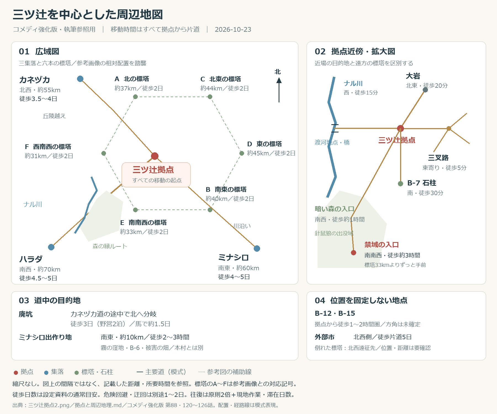

# 三ツ辻中心・移動参照地図

作成：2026-10-23。コメディ強化版の執筆・修正時に参照する配置図。

- [PNG画像](三ツ辻中心_移動参照地図.png)
- [編集用SVG](三ツ辻中心_移動参照地図.svg)
- [生成スクリプト](../../scripts/draw_mitsutsuji_map.py)

## 読み方

北が上。広域図と近傍図はどちらも縮尺なし。図上の長さから距離を測らず、ラベルの数値を参照する。主要道の線・河道・森の輪郭は模式表現であり、詳細な経路や地形境界を新しく確定するものではない。

広域図は[三ツ辻拠点2.png](../../辺境拠点日誌/設定/三ツ辻拠点2.png)の、三ツ辻と三集落・周囲六標塔の相対配置を参照した。A〜Fは元画像との対応用の位置記号で、作中の標塔名・A系統ノード番号ではない。緑の破線は配置を見比べる補助線であり、道路や移動可能な通路を意味しない。元画像の外周G〜Xは、三ツ辻からの所要時間が決まっていないため省略した。

所要時間は**三ツ辻拠点から目的地までの片道**。往復は原則その二倍に、調査・滞在・待機時間を加える。「目的地で二日調べる」と「往復二日」を区別する。

## 三集落への移動

| 目的地 | 拠点からの方角 | 設定資料の距離 | 徒歩片道 | 荷馬車片道 | 主な道筋 |
|---|---|---|---|---|---|
| カネヅカ | 北西 | 約55km | 約3.5〜4日 | 約5〜6日 | 丘陵越え |
| ミナシロ本村 | 南東 | 約60km | 約4〜5日 | 約6〜7日 | 川沿い |
| ハラダ | 南西 | 約70km | 約4.5〜5日 | 約7〜8日 | 森の縁 |

日数は設定資料にある通常の移動目安。危険生物の回避・迂回がある旅は、資料の記載に従いさらに約1〜2日を見込む。同じ旅程の行きと帰りで、この追加条件を変えるなら理由を記す。

距離が直線距離か道なり距離かは資料で明確に区別されていないため、この地図でも測量値に読み替えない。距離を歩行速度で割って、表の日数を別の数字に置き換えない。

## 拠点近傍

| 目的地 | 拠点からの方角 | 徒歩片道 | 注意 |
|---|---|---|---|
| 三叉路 | 東寄り | 約5分 | 拠点名の由来。三集落へ道が分かれる |
| ナル川の水場 | 西 | 約15分 | すべての渡河地点が15分という意味ではない |
| 大岩 | 北東 | 約20分 | 展望・偵察地点 |
| B-7石柱 | 南 | 約30分 | 禁域の入口・標塔基部とは別地点 |
| 暗い森の入口 | 南西 | 約1時間 | 森全体や針鼠狼の全縄張りまで1時間という意味ではない |
| 禁域の入口 | 南南西 | 約3時間 | 旧B区画。日帰り圏だが、内部調査の時間は別に加える |
| ミナシロ出作り地 | 南東 | 約2〜3時間／約10km | 霧の窪地・B-6・草毛獣被害の畑。60km先の本村とは別 |
| B-12・B-15 | ※方角未確定 | 約1〜2時間圏 | 地図に正確な位置は置かない |

暗い森の入口・禁域入口の時間は、関連設定資料の現行の整理を採用した。

## 標塔

| 元画像の位置記号 | 作中の呼称 | 方角 | 拠点からの距離 | 徒歩片道の目安 |
|---|---|---|---|---|
| A | 北の標塔 | ほぼ北 | 約37km | 約2日 |
| B | 南東の標塔 | 南東 | 約40km | 約2日 |
| C | 北東の標塔 | 北東 | 約44km | 約2日 |
| D | 東の標塔 | 東〜東南東 | 約45km | 約2日 |
| E | 南南西の標塔 | 南南西 | 約33km | 約2日 |
| F | 西南西の標塔 | 西南西 | 約31km | 約2日 |

徒歩約2日は設定資料の「標塔の基部へ行く調査は片道2日」を共通の目安として表示したもの。六地点すべての実測旅程が個別に確定しているという意味ではない。基部への調査は宿泊を含めて組み、遠くに頂部が見えることと近くまで行けることを区別する。

**南南西の標塔（約33km・約2日）と禁域入口（約3時間）は別地点。** B-7も徒歩約30分の別地点である。クストスの部屋がある遠征先の点検口も、B-7の地下や近場の禁域入口に重ねない。

## 遠方・経路途中の目的地

| 目的地 | 分かっている位置関係 | 所要時間 | 未確定部分 |
|---|---|---|---|
| 廃坑 | カネヅカ道の途中で北へ外れる | 徒歩片道約3日・野営2泊／馬で約1.5日 | 距離と分岐点の正確な位置 |
| 外部市 | 北西側・三集落の安全圏外 | 徒歩片道約5日 | 正確な距離・座標・経路 |
| 倒れた標塔・点検口 | 第120話以降の北西遠征先 | 作中ではウロジカ遠征の二日目に視認、帰路も二日 | 正確な距離・座標、徒歩所要日数の全行程 |

第120話の「歩けば五日かかった距離を今日中に越える」は、その日に進む区間の比較である。これをそのまま「倒れた標塔まで徒歩五日」や「ウロジカなら全員どこへでも五倍速」として固定しない。

※要確認：B-12・B-15の方角、外部市・倒れた標塔の具体的位置、廃坑への分岐点は、今後本文を整理する際に別途確定する。この図では未確定箇所に座標を与えていない。

## 出典

- 配置の参照：[三ツ辻拠点2.png](../../辺境拠点日誌/設定/三ツ辻拠点2.png)
- 距離・近傍地点・旅程の基準：[拠点と周辺地理.md](../../辺境拠点日誌/設定/拠点と周辺地理.md)の「周辺の重要な地点」「三ツ辻を囲む6本の標塔」「移動時間・距離の目安」。共通設定資料として参照し、通常版本文の点検・変更は行っていない。
- 外部市・倒れた標塔の旅程：コメディ強化版 第88話、第120〜126話。
- 既知の食い違い：[99_矛盾・未解決事項リスト.md](../../設定ドキュメント/99_矛盾・未解決事項リスト.md)。この図は本文修正や未解決項目の解決を確定するものではない。
